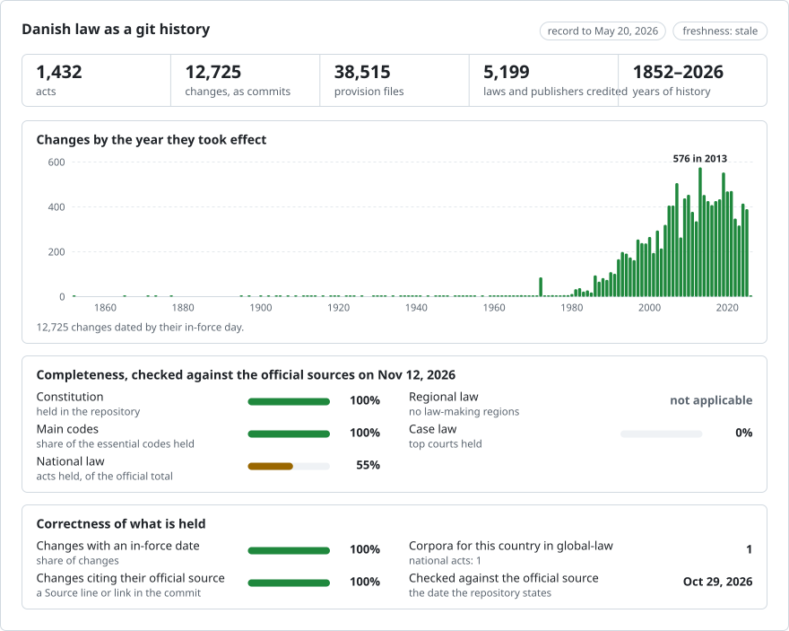

# Denmark: law history in git

**English** · **[Eller læs den på dansk](README.md)**

<picture>
<source media="(prefers-color-scheme: dark)" srcset="data/effort-dark.svg">

</picture>

The law of Denmark as a git history: one file per section (§), one commit per amending act on the day it took effect, and the act that made each change as the commit's author. `git blame` names the act behind every line; `git log` lists every change to a section; picking a date gives the text in force that day.

Part of [lexifina/global-law](https://github.com/lexifina/global-law), one git history for every country's law: this is Denmark's national law, which global-law reads at `denmark/national/acts/`.

**What is in it now:** the 1,432 statutes Retsinformation lists as in force, from 1852 to 2025, the Constitution of 1953 among them; their 4,131 official texts (each act's first text and 2,699 later consolidations, lovbekendtgørelser); and the changes of the 4,130 amending acts and orders those consolidations incorporate, in 12,725 commits. [`love.csv`](love.csv) lists every act, consolidation and amending act with its dates.

Each act is a folder `<kind>/<year>/<number>/`: the act as passed (`lov/`) or, for the 140 acts whose act as passed Retsinformation does not hold, its first consolidation (`lbk/`). Each section is one file: `lbk/1971/413/par-007.md` is § 7 of Funktionærloven, the Salaried Employees Act (LBK nr 413 af 30/08/1971); the Constitution is in [`lov/1953/169/`](lov/1953/169/). Until 10 November 2026 the folders had short names (`funktionaerloven/`); [`data/paths.json`](data/paths.json) maps each to its folder, and `git blame` and `git log --follow` follow a file across the move.

The text is in Danish, as Retsinformation publishes it. An English translation is not part of this record.

## Questions as git commands

| Question | Command |
| --- | --- |
| Every change to § 7 of the Salaried Employees Act | `git log -p --word-diff --follow -- lbk/1971/413/par-007.md` |
| Which act wrote each line of § 7? | `git blame lbk/1971/413/par-007.md` |
| Every version of § 7, with the day each took effect | `git log --follow --diff-filter=AM --format="%h %(trailers:key=In-force,valueonly,separator=) %an" -- lbk/1971/413/par-007.md` |
| § 7 as in force on 1 January 2000 | `python tools/paa_dato.py 2000-01-01 funktionaerloven 7` |

**Outside git**, we also host this record publicly, for free:

- **[Ask Claude about Danish law](https://global-law.lexifina.com/v1/try_claude?country=denmark)**: opens Claude with a first question ready.
- **[Ask ChatGPT](https://global-law.lexifina.com/v1/try_chatgpt?country=denmark)**: the same question in ChatGPT.
- **[Search Danish law on our site](https://lexifina.com/law?country=denmark&q=ferie)**: a search for "ferie", with each provision's text and its versions, no account needed.
- **[Developer REST API](https://global-law.lexifina.com/v1/search_law?query=ferie&jurisdiction=denmark)**: the same search as JSON, with no key. See the [documentation here](https://lexifina.com/api/global-law).

Both assistants read the record through the free Global law connector (MCP, `https://global-law.lexifina.com/mcp`); the first time, the chat gives you the link that adds it. Ask in Danish or in English.

**Host it yourself easily.** All it takes is git and Python, and the tools run on your machine:

```sh
git clone --depth 1 https://github.com/lexifina/global-law && cd global-law
python3 tools/countries.py add denmark/national/acts
python3 tools/law.py show 2026-01-01 denmark/national/acts/lbk/1971/413/par-007.md
```

Opened in Claude Code, Cursor, VS Code or Codex, the clone also starts a local MCP server with the same tools ([MCP.md](https://github.com/lexifina/global-law/blob/main/MCP.md)).

## Dates

Each commit is dated at noon, Europe/Copenhagen, on the day the version took effect, and carries it in its `In-force:` trailer, beside the days the act was passed (`Enacted:`) and published in Lovtidende (`Published:`):

- for an amending act, the day its own commencement sentence gives for the provisions it changed ("Loven træder i kraft den 1. januar 2020"), quoted in the commit; where the act leaves the day to a minister, or the sentence cannot be read, the day of the next consolidation (`Date-note: undated`);
- for a consolidation, the day Retsinformation gives as its first valid day; for consolidations from before 1999, where that is the day Retsinformation loaded them, long after, the day of publication (`Date-note: load-day`);
- git cannot store dates before 1970, so the 113 earlier commits are dated from 1970-01-01, seconds apart, with the real day in `In-force:`. Ask for a date with `tools/paa_dato.py`, not `git log --before`.

Each change is credited to the amending act whose article names the section it changed (`LOV nr 340 af 02/06/1999`); the first version of an act is credited to the act itself. Changes more than one act could explain (named in `Candidate:` trailers), changes no act explains, each consolidation's own words and the first text of the 140 acts that begin with a consolidation are committed by `Retsinformation (Civilstyrelsen)`, never credited to an act on a guess.

## How it is checked

- `tools/check_repo.py` reads each of the 4,131 official texts back from git on the day it took effect and compares it file by file with the text parsed from Retsinformation's HTML (0 mismatches), and word for word with the whole document read without the parser (3 versions differ in word order or a formula; they are listed).
- `tools/test_repo.py` checks that blame names an act, that the dated tool gives the text before and after an amendment, that every tag resolves and that every law commit carries `In-force:`.
- A second build from the same retrieved data gave the same hash for every commit and tag. The commands and results are in [`REPRODUCE.md`](REPRODUCE.md).
- History is append-only: later builds are appended, and no published commit is rewritten.

## What it does not show

- **Acts no longer in force, and executive orders** (bekendtgørelser): the record holds the statutes Retsinformation listed as in force on 29 October 2026.
- **Amending acts passed after an act's latest consolidation.** Retsinformation has no consolidated text for them yet, so their changes wait for the next consolidation.
- **History before Retsinformation's first text.** For the 140 acts that begin with a consolidation, earlier changes are not here.
- **The days between consolidations as official texts.** Retsinformation publishes a text only on each consolidation's day; between them, each act's changes are placed on its own in-force day with the wording the next consolidation shows. Only an act's first text and the commits tagged `lbk/<year>-<number>` are official texts.

## Sources

| Source | Kind | Past versions | Notes |
| --- | --- | --- | --- |
| [Retsinformation](https://www.retsinformation.dk) (Civilstyrelsen) | Official legal database: acts as passed (LOV) and consolidations (LBK) | yes, the act as passed and every consolidation it holds | The text of each version, its first valid day and the amending acts it incorporates; the authoritative publication is Lovtidende |

## Licence

See [`LICENSE`](LICENSE). Statutes are not protected by copyright in Denmark (ophavsretsloven § 9), and Civilstyrelsen gives a free, non-exclusive and unlimited right to use Retsinformation's open data. Source: Retsinformation (Civilstyrelsen), www.retsinformation.dk; Civilstyrelsen does not endorse this repository. The history, commit messages, tables and tools are CC0 1.0.

No AI model wrote or changed legal text; the scripts were written by an AI model (see [`REPRODUCE.md`](REPRODUCE.md)).

## More

From [lexifina/global-law](https://github.com/lexifina/global-law):

- [FEATURES.md](https://github.com/lexifina/global-law/blob/main/FEATURES.md): every feature, and what every corpus must support (`git blame`, `law.py`, the MCP tools)
- [FAQ.md](https://github.com/lexifina/global-law/blob/main/FAQ.md): questions and answers · [CONTRIBUTING.md](https://github.com/lexifina/global-law/blob/main/CONTRIBUTING.md): proposing changes · [MCP.md](https://github.com/lexifina/global-law/blob/main/MCP.md): the MCP server · [REPRODUCE.md](https://github.com/lexifina/global-law/blob/main/REPRODUCE.md): how it was built · [CHANGELOG.md](https://github.com/lexifina/global-law/blob/main/CHANGELOG.md)
- [FRESHNESS.md](https://github.com/lexifina/global-law/blob/main/FRESHNESS.md): how current each corpus is · [Monitoring](https://github.com/lexifina/global-law/tree/main/monitoring): whether updates are running · [WATCHING.md](https://github.com/lexifina/global-law/blob/main/WATCHING.md): how each official source is watched for changes
- [performance/](https://github.com/lexifina/global-law/tree/main/performance): how fast the tools are, measured
- [visualisations/](https://github.com/lexifina/global-law/tree/main/visualisations): charts and bridges across the world's law
- [Vulnerabilities](https://github.com/lexifina/global-law/tree/main/vulnerabilities): mistakes in legislation as published
