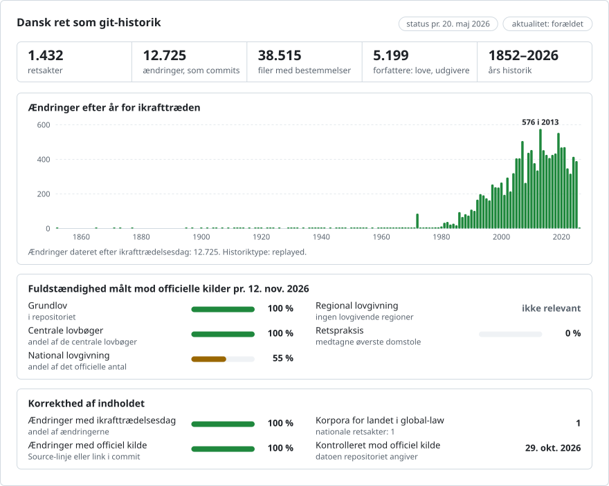

# Dansk lovgivning, ændring for ændring

**Dansk** · [English](README.en.md)

<picture>
<source media="(prefers-color-scheme: dark)" srcset="data/da/effort-dark.svg">

</picture>

Del af [lexifina/global-law](https://github.com/lexifina/global-law), én git-historik for alle landes ret: dette er Danmarks nationale lovgivning, som global-law læser under `denmark/national/acts/`.

Alle gældende danske love som et git-repositorie: 1.432 retsakter (love og lovbekendtgørelser), som Retsinformation viser
som gældende, fra den ældste (1852) til lovene fra 2025, herunder Grundloven fra 1953, hver med alle de lovbekendtgørelser,
Retsinformation har, og de ændringslove, der ligger imellem dem. Hver ændringslov er ét commit, tilskrevet den pågældende lov
og dateret den dag, den trådte i kraft, kl. 12 i København. Teksten er den tekst, Civilstyrelsen udgiver i
[Retsinformation](https://www.retsinformation.dk), på dansk.

| | |
| --- | --- |
| Love | 1.432 (1.292 fra loven som vedtaget, 140 fra deres første lovbekendtgørelse i Retsinformation) |
| Officielle tekster | 4.131 (hver lovs første tekst og 2.839 lovbekendtgørelser, hver identisk med Retsinformations) |
| Commits | 12.725 lov-commits, fra 1852-01-28 til 2026-05-20 |
| Tilskrevne ændringslove | 3.974 |
| Tags | 19.131 |

## Spørgsmålene som git-kommandoer

| Spørgsmål | Kommando |
| --- | --- |
| Hvad sagde § 5 i skatteforvaltningsloven den 1. januar 2016? | `python tools/paa_dato.py 2016-01-01 skatteforvaltningsloven 5` |
| § 266 b i straffeloven den 1. januar 2000 | `python tools/paa_dato.py 2000-01-01 straffeloven 266b` |
| Hele funktionærloven, som den lød den 1. januar 2010 | `python tools/paa_dato.py 2010-01-01 funktionaerloven` |
| § 20 i Grundloven | `python tools/paa_dato.py 2000-01-01 grundloven 20` |
| Hvilken lov skrev hvert stykke i § 5? | `git blame skatteforvaltningsloven/par-005.md` |
| Alle ændringer af § 5, med loven og dagen | `git log --follow skatteforvaltningsloven/par-005.md` |
| Alt, hvad én ændringslov ændrede, i alle love | `git show --stat lov/2023-1535` |
| Hvad der blev ændret i én lov på én dag | `git show --stat skatteforvaltningsloven/2020-01-01` |
| Alle ændringslove, der har ændret straffeloven | `git log --format=%an -- straffeloven` |
| Lovene og lovbekendtgørelserne med alle deres datoer | [`love.csv`](love.csv) |
| Lovbekendtgørelserne | `git log --grep="(lovbekendtgørelse)"` |
| Ændringer, som mere end én lov kan forklare | `git log --grep="Candidate:"` |
| Ændringer, hvis dag ikke er læst i loven | `git log --grep="Date-note: undated"` |

## Datoerne, og hvilken vi bruger

En dansk lov har den dag, den blev vedtaget (`Enacted:`, den dag kongen eller dronningen underskrev den), den dag, den blev
kundgjort i Lovtidende (`Published:`), og den dag, den trådte i kraft (`In-force:`). **Commits er dateret den dag, ændringen
trådte i kraft**, kl. 12 i København (CET, eller CEST i sommertid): det er den dag, der afgør, hvilken tekst der gælder. Dagen
læses i ændringslovens egen ikrafttrædelsesbestemmelse ("Loven træder i kraft den 1. januar 2020", "§ 1, nr. 3, træder i
kraft den ..."), som citeres i commit'et. Hvor en lov overlader det til en minister at fastsætte dagen, bruges
lovbekendtgørelsens dag, og commit'et oplyser det (`Date-note: undated`). Alle tre datoer står i hver commit-besked. Git kan
ikke gemme en dato før 1970, så commits for ændringer før 1970 (herunder Grundloven af 5. juni 1953) er dateret 1. januar
1970 med sekunders mellemrum i den rigtige rækkefølge, og deres egentlige dag står i `In-force:`, som `tools/paa_dato.py`
læser.

Alle love deler én historik i den rækkefølge, deres ændringer trådte i kraft. En ændringslov, der ændrer flere love samme
dag, er ét commit, som nævner hver lov med dens bestemmelser.

## Hvad "forfatter" betyder

Forfatteren til et commit er den lov, der foretog ændringen: `LOV nr 1125 af 19/11/2019` (med en adresse, der ender på
`@retsinformation.invalid`, som ikke kan eksistere), så `git blame` nævner loven. Hvor en lovbekendtgørelse blandt de
dokumenter, den indarbejder, nævner en bekendtgørelse (`BEK nr ...`, for eksempel en, der flytter opgaver mellem
ministerier), er denne bekendtgørelse forfatter til de ændringer, den foretog. Retsinformation markerer ikke, hvilken lov
der ændrede hvilken bestemmelse. Den udgiver loven som vedtaget og hver senere lovbekendtgørelse, og hver lovbekendtgørelse
oplyser, hvilke ændringslove den indarbejder, og hvilken artikel i hver af dem. Byggeprocessen læser denne artikel i
ændringsloven, tager hvert nummer og de bestemmelser, det nævner, og tilskriver en ændret bestemmelse den lov, der nævner
den. Tre yderligere regler, hver mærket i commit'et: et nummer, der siger "overalt i loven", gælder for alle bestemmelser;
en bestemmelse, hvis nye ordlyd citeres i præcis én lov i perioden, tilskrives denne lov; og overskrifter over lovens
afsnit, der flyttede med en bestemmelse, følger den lov, der ændrede den.

Hvor mere end én lov nævner en bestemmelse, eller ingen gør, viser lovbekendtgørelsen kun resultatet: sådanne ændringer
committes af `Retsinformation (Civilstyrelsen)`, har "(flere love)" i emnelinjen og nævner lovene i `Candidate:`-trailere,
eller de mærkes som ikke forklaret af nogen ændringsartikel. De tilskrives aldrig en lov på et gæt. En lovbekendtgørelses
egne indledningsord, underskrifter og noter committes også af Retsinformation. Committer er altid `Lexifina`.

## Hvor en lov begynder

For de fleste love er det første commit loven som vedtaget, tilskrevet loven selv. For 140 ældre love har Retsinformation
ikke loven som vedtaget; deres første commit er den første lovbekendtgørelse, Retsinformation har, som genoptrykker loven
med alle ændringer foretaget indtil da. Dette commit er fra `Retsinformation (Civilstyrelsen)`, har "(første tekst i
Retsinformation)" i emnelinjen og tilskriver ingen lov: disse loves historik før denne lovbekendtgørelse er ikke med i
dette materiale.

## Hvad der er officielt, og hvad der er rekonstrueret

Retsinformation udgiver kun teksten på lovbekendtgørelsernes dage. Mellem to lovbekendtgørelser træder flere love i kraft
på forskellige dage, og der findes ingen tekst for dagene imellem. Commits mellem lovbekendtgørelsesdagene er derfor
rekonstrueret: hver lovs ændringer optræder på dens egen ikrafttrædelsesdag med den ordlyd, som den næste
lovbekendtgørelse viser. **Kun en lovs tilstand på en lovbekendtgørelses dag (det commit, der er tagget
`lbk/<year>-<number>`) og på dens første dag er officiel tekst, og den er identisk med Retsinformations tekst, fil for
fil.** Ord for ord er den også identisk, bortset fra de få versioner, der er opført i [`REPRODUCE.md`](REPRODUCE.md), hvis
trykte rækkefølge filerne ikke kan følge (en paragraf trykt uden for sin nummerorden, en formel sat med sænket skrift).

## Hvordan det kontrolleres

`tools/check_repo.py` læser hver officiel version af hver lov tilbage fra git på den dag, den trådte i kraft, og
sammenligner den med den officielle tekst: fil for fil med teksten, som den er parset fra Retsinformations HTML, og ord for
ord med alle dokumentets bogstaver og cifre, læst uafhængigt af parseren. `tools/test_repo.py` kontrollerer, at
kommandoerne ovenfor virker. Resultaterne står i [`REPRODUCE.md`](REPRODUCE.md).

## Filer

Hver lov er en mappe opkaldt efter lovens korttitel (`straffeloven/`, `funktionaerloven/`) eller, hvor den ikke har nogen,
efter dens titel og nummer. Hver bestemmelse (§) er én fil: `par-005.md` er § 5, `par-035b.md` er § 35 b; hvor en lov
trykker samme nummer to gange (nogle ældre love og tiltrædelseslovene fra 1972), er den anden `par-002-dup.md`, den tredje
`par-002-dup2.md`; sådanne filer og de paragraffer efter en gentagelse, der hører til samme anden nummerrække
(`par-046a-dup.md`), kommer efter de almindelige paragraffer. Et nummer, der trykkes igen lige efter sig selv, hvorefter de
almindelige paragraffer fortsætter (indfødsretslovenes "§ 1. ... § 1. ... § 2."), er `par-001-igen.md`, som læses lige
efter det første. Overskrifterne over de dele af loven, der begynder med en bestemmelse, er `##`-linjer øverst i
bestemmelsens fil; hvert stykke (stk.) og hvert listepunkt er én linje. `indledning.md` er titlen og indledningsordene,
`ikraft.md` de ikrafttrædelsesbestemmelser i ændringslove, som en lovbekendtgørelse genoptrykker efter sin sidste paragraf
("Lov nr. 285 af 13. maj 1987 ... indeholder følgende ikrafttrædelsesbestemmelse: § 2. ..."; de er ikke bestemmelser i
loven), `slut.md` underskrifterne, `bilag.md` paragraffer trykt efter underskrifterne (en ældre lov eller en ændringslovs
bestemmelser, som en lovbekendtgørelse genoptrykker dér) og `noter.md` fodnoterne. En paragraf, som en ændringsbestemmelse
citerer som ny ordlyd (»§ 5 a. ...«), forbliver i filen for den paragraf, der citerer den. En ophævet bestemmelse forbliver
en fil med "(Ophævet)", sådan som Retsinformation trykker den.

Hver lovs mappe har en `README.md`, der viser lovens bestemmelser, og hvor ofte hver af dem er ændret.
[`love.csv`](love.csv) viser hver version og ændringslov med deres datoer; [`data/versioner.json`](data/versioner.json)
hvert læst dokument med dets sha256; [`data/ikke-tilskrevet.csv`](data/ikke-tilskrevet.csv) hver ændring, der ikke er
tilskrevet nogen lov, og hvorfor; [`data/udeladt.csv`](data/udeladt.csv) enhver lov, der er udeladt, fordi den ikke kunne
læses. [`corpus.json`](corpus.json) beskriver korpusset for værktøjer, der læser flere af Lexifinas lov-repositorier.

## Hvad det ikke viser

- Love, der ikke længere er i kraft, og bekendtgørelser: materialet omfatter de love, som Retsinformation viste som
  gældende pr. 2026-10-29.
- Love vedtaget efter en lovs seneste lovbekendtgørelse: Retsinformation har endnu ingen konsolideret tekst for dem, så
  deres ændringer venter på den næste lovbekendtgørelse.
- En lovs historik før dens første tekst i Retsinformation (se ovenfor).
- Dagene mellem lovbekendtgørelser som officielle tekster (se ovenfor).

Teksten i Retsinformation er til orientering; den autoritative udgivelse er Lovtidende.

## Hvordan det er bygget

`tools/build.py` læser Retsinformation og skriver dette repositorie fra bunden; de samme data giver de samme hashes. Hvert
trin, softwaren, de beslutninger, der er truffet manuelt, og hvad en AI-model har gjort, står i
[`REPRODUCE.md`](REPRODUCE.md).

## Licens

Love er ikke genstand for ophavsret i Danmark (ophavsretsloven § 9), og Civilstyrelsen giver en gratis, ikke-eksklusiv og
ubegrænset ret til at bruge Retsinformations åbne data. Kilde: Retsinformation (Civilstyrelsen), www.retsinformation.dk.
Data bruges ikke til at antyde, at Civilstyrelsen støtter eller anbefaler dette repositorie. Dette repositorie er privat;
historikken, commit-beskederne, tabellerne og værktøjerne er frigivet under [CC0 1.0](LICENSE).

Dette er en oversættelse af den engelske version ([README.en.md](README.en.md)); hvis de afviger, gælder den engelske version.

## Mere

Fra repositoriet [lexifina/global-law](https://github.com/lexifina/global-law) (på engelsk):

- [FEATURES.md](https://github.com/lexifina/global-law/blob/main/FEATURES.md): alle funktioner og hvad hvert korpus skal understøtte (`git blame`, `law.py`, MCP-værktøjer)
- [FAQ.md](https://github.com/lexifina/global-law/blob/main/FAQ.md): spørgsmål og svar · [CONTRIBUTING.md](https://github.com/lexifina/global-law/blob/main/CONTRIBUTING.md): foreslå ændringer · [MCP.md](https://github.com/lexifina/global-law/blob/main/MCP.md): MCP-server · [REPRODUCE.md](https://github.com/lexifina/global-law/blob/main/REPRODUCE.md): hvordan det er bygget · [CHANGELOG.md](https://github.com/lexifina/global-law/blob/main/CHANGELOG.md)
- [FRESHNESS.md](https://github.com/lexifina/global-law/blob/main/FRESHNESS.md): hvor aktuelt hvert korpus er · [Overvågning](https://github.com/lexifina/global-law/tree/main/monitoring): om opdateringerne virker · [WATCHING.md](https://github.com/lexifina/global-law/blob/main/WATCHING.md): hvordan hver officiel kilde overvåges for ændringer
- [performance/](https://github.com/lexifina/global-law/tree/main/performance): hvor hurtige værktøjerne er, målt
- [visualisations/](https://github.com/lexifina/global-law/tree/main/visualisations): diagrammer og forbindelser på tværs af hele verdens ret
- [Sårbarheder](https://github.com/lexifina/global-law/tree/main/vulnerabilities): fejl i retsakter, som de er offentliggjort
