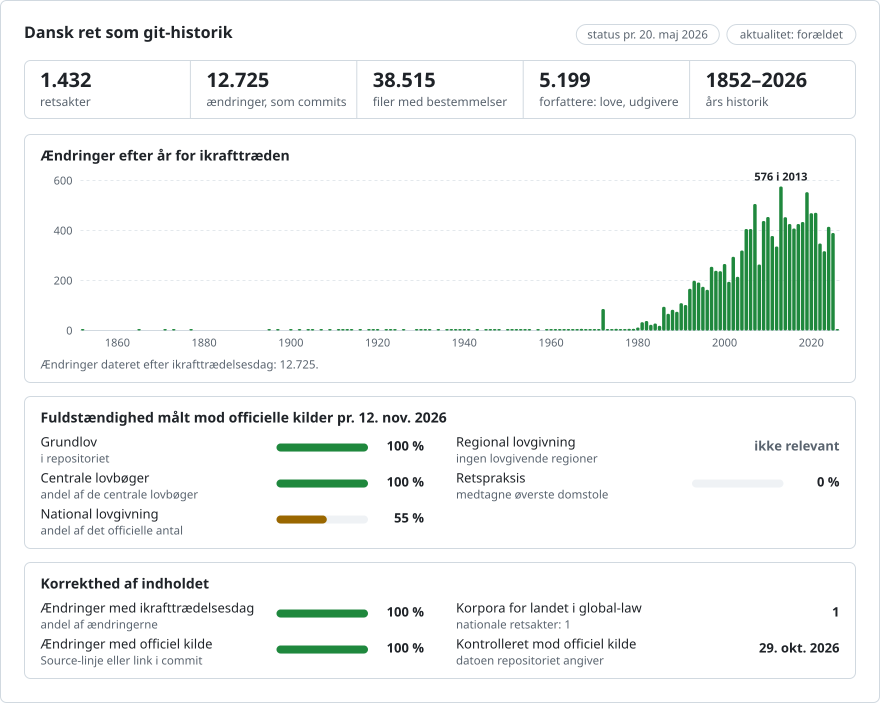

# Danmark: lovhistorik i git

**Dansk** · **[Or read it in English](README.en.md)**

<picture>
<source media="(prefers-color-scheme: dark)" srcset="data/da/effort-dark.svg">

</picture>

Danmarks ret som git-historik: én fil pr. paragraf (§), ét commit pr. ændringslov på den dag, den trådte i kraft, og den lov, der foretog hver ændring, som commit'ets forfatter. `git blame` viser den lov, der står bag hver linje; `git log` viser hver ændring af en paragraf; vælger man en dato, får man den tekst, der var gældende den dag.

Del af [lexifina/global-law](https://github.com/lexifina/global-law), én git-historik for alle landes ret: dette er Danmarks nationale ret, som global-law læser under `denmark/national/acts/`.

**Hvad det indeholder nu:** de 1.432 love, som Retsinformation viser som gældende, fra 1852 til 2025, herunder Grundloven fra 1953; deres 4.131 officielle tekster (hver lovs første tekst og 2.699 senere lovbekendtgørelser); og ændringerne fra de 4.130 ændringslove og bekendtgørelser, som lovbekendtgørelserne indarbejder, i 12.725 commits. [`love.csv`](love.csv) viser hver lov, lovbekendtgørelse og ændringslov med deres datoer.

Hver lov er en mappe `<art>/<år>/<nummer>/`: loven som vedtaget (`lov/`) eller, for de 140 love, hvor Retsinformation ikke har loven som vedtaget, dens første lovbekendtgørelse (`lbk/`). Hver paragraf er én fil: `lbk/1971/413/par-007.md` er § 7 i Funktionærloven (LBK nr 413 af 30/08/1971); Grundloven ligger i [`lov/1953/169/`](lov/1953/169/). Indtil 10. november 2026 havde mapperne korte navne (`funktionaerloven/`); [`data/paths.json`](data/paths.json) knytter hvert navn til sin mappe, og `git blame` og `git log --follow` følger en fil hen over flytningen.

Teksten er på dansk, sådan som Retsinformation udgiver den. En engelsk oversættelse er ikke en del af dette materiale.

## Spørgsmål som git-kommandoer

| Spørgsmål | Kommando |
| --- | --- |
| Hver ændring af § 7 i Funktionærloven | `git log -p --word-diff --follow -- lbk/1971/413/par-007.md` |
| Hvilken lov skrev hver linje i § 7? | `git blame lbk/1971/413/par-007.md` |
| Hver version af § 7 med den dag, den trådte i kraft | `git log --follow --diff-filter=AM --format="%h %(trailers:key=In-force,valueonly,separator=) %an" -- lbk/1971/413/par-007.md` |
| § 7, som den gjaldt den 1. januar 2000 | `python tools/paa_dato.py 2000-01-01 funktionaerloven 7` |

**Uden for git** stiller vi også materialet offentligt og gratis til rådighed:

- **[Spørg Claude om dansk ret](https://global-law.lexifina.com/v1/try_claude?country=denmark)**: åbner Claude med et første spørgsmål klar.
- **[Spørg ChatGPT](https://global-law.lexifina.com/v1/try_chatgpt?country=denmark)**: det samme spørgsmål i ChatGPT.
- **[Kald API'et i din browser](https://global-law.lexifina.com/v1/search_law?query=ferie&jurisdictions=denmark)**: en søgning i dansk ret efter "ferie", returneret som JSON. Dokumentationen findes [her](https://lexifina.com/api/global-law).

Begge assistenter læser materialet gennem den gratis Global law-connector (MCP, `https://global-law.lexifina.com/mcp`); første gang giver chatten dig det link, der tilføjer den. Spørg på dansk eller på engelsk.

**Kør det nemt selv.** Det eneste, der skal til, er git og Python, og værktøjerne kører på din egen computer:

```sh
git clone --depth 1 https://github.com/lexifina/global-law && cd global-law
python3 tools/countries.py add denmark/national/acts
python3 tools/law.py show 2026-01-01 denmark/national/acts/lbk/1971/413/par-007.md
```

Åbnet i Claude Code, Cursor, VS Code eller Codex starter klonen også en lokal MCP-server med de samme værktøjer ([MCP.md](https://github.com/lexifina/global-law/blob/main/MCP.md)).

## Datoer

Hvert commit er dateret kl. 12 dansk tid (Europe/Copenhagen) på den dag, versionen trådte i kraft, og har dagen i sin `In-force:`-trailer ved siden af de dage, hvor loven blev vedtaget (`Enacted:`) og kundgjort i Lovtidende (`Published:`):

- for en ændringslov den dag, som dens egen ikrafttrædelsesbestemmelse angiver for de bestemmelser, den ændrede ("Loven træder i kraft den 1. januar 2020"), citeret i commit'et; hvor loven overlader det til en minister at fastsætte dagen, eller bestemmelsen ikke kan læses, den næste lovbekendtgørelses dag (`Date-note: undated`);
- for en lovbekendtgørelse den dag, Retsinformation angiver som dens første gyldighedsdag; for lovbekendtgørelser fra før 1999, hvor det er den dag, Retsinformation indlæste dem, længe efter, kundgørelsesdagen (`Date-note: load-day`);
- git kan ikke gemme datoer før 1970, så de 113 tidligere commits er dateret fra 1970-01-01 med sekunders mellemrum, og den egentlige dag står i `In-force:`. Spørg efter en dato med `tools/paa_dato.py`, ikke med `git log --before`.

Hver ændring tilskrives den ændringslov, hvis artikel nævner den paragraf, der blev ændret (`LOV nr 340 af 02/06/1999`); en lovs første version tilskrives loven selv. Ændringer, som mere end én lov kan forklare (nævnt i `Candidate:`-trailere), ændringer, som ingen lov forklarer, hver lovbekendtgørelses egne ord og den første tekst for de 140 love, der begynder med en lovbekendtgørelse, committes af `Retsinformation (Civilstyrelsen)` og tilskrives aldrig en lov på et gæt.

## Hvordan det kontrolleres

- `tools/check_repo.py` læser hver af de 4.131 officielle tekster tilbage fra git på den dag, den trådte i kraft, og sammenligner den fil for fil med teksten, som den er parset fra Retsinformations HTML (0 afvigelser), og ord for ord med hele dokumentet, læst uden parseren (3 versioner afviger i ordenes rækkefølge eller i en formel; de er opført).
- `tools/test_repo.py` kontrollerer, at blame nævner en lov, at datoværktøjet giver teksten før og efter en ændring, at hvert tag kan slås op, og at hvert lov-commit har `In-force:`.
- En ny kørsel af byggeprocessen fra de samme hentede data gav den samme hash for hvert commit og hvert tag. Kommandoerne og resultaterne står i [`REPRODUCE.md`](REPRODUCE.md).
- Historikken bygges kun videre: senere kørsler tilføjes, og intet offentliggjort commit omskrives.

## Hvad det ikke viser

- **Love, der ikke længere er i kraft, og bekendtgørelser**: materialet omfatter de love, som Retsinformation viste som gældende den 29. oktober 2026.
- **Ændringslove vedtaget efter en lovs seneste lovbekendtgørelse.** Retsinformation har endnu ingen konsolideret tekst for dem, så deres ændringer venter på den næste lovbekendtgørelse.
- **Historik før Retsinformations første tekst.** For de 140 love, der begynder med en lovbekendtgørelse, er tidligere ændringer ikke med.
- **Dagene mellem lovbekendtgørelser som officielle tekster.** Retsinformation udgiver kun en tekst på hver lovbekendtgørelses dag; ind imellem placeres hver lovs ændringer på dens egen ikrafttrædelsesdag med den ordlyd, som den næste lovbekendtgørelse viser. Kun en lovs første tekst og de commits, der er tagget `lbk/<år>-<nummer>`, er officielle tekster.

## Kilder

| Kilde | Art | Tidligere versioner | Bemærkninger |
| --- | --- | --- | --- |
| [Retsinformation](https://www.retsinformation.dk) (Civilstyrelsen) | Officiel retsdatabase: love som vedtaget (LOV) og lovbekendtgørelser (LBK) | ja, loven som vedtaget og hver lovbekendtgørelse, Retsinformation har | Teksten i hver version, dens første gyldighedsdag og de ændringslove, den indarbejder; den autoritative udgivelse er Lovtidende |

## Licens

Se [`LICENSE`](LICENSE). Love er ikke genstand for ophavsret i Danmark (ophavsretslovens § 9), og Civilstyrelsen giver en gratis, ikke-eksklusiv og ubegrænset brugsret til Retsinformations åbne data. Kilde: Retsinformation (Civilstyrelsen), www.retsinformation.dk; Civilstyrelsen står ikke bag dette repositorie. Historikken, commit-beskederne, tabellerne og værktøjerne er frigivet under CC0 1.0.

Ingen AI-model har skrevet eller ændret lovtekst; scriptene er skrevet af en AI-model (se [`REPRODUCE.md`](REPRODUCE.md)).

Dette er en oversættelse af den engelske version ([README.en.md](README.en.md)); hvis de afviger, gælder den engelske version.

## Mere

Fra repositoriet [lexifina/global-law](https://github.com/lexifina/global-law) (på engelsk):

- [FEATURES.md](https://github.com/lexifina/global-law/blob/main/FEATURES.md): alle funktioner og hvad hvert korpus skal understøtte (`git blame`, `law.py`, MCP-værktøjer)
- [FAQ.md](https://github.com/lexifina/global-law/blob/main/FAQ.md): spørgsmål og svar · [CONTRIBUTING.md](https://github.com/lexifina/global-law/blob/main/CONTRIBUTING.md): foreslå ændringer · [MCP.md](https://github.com/lexifina/global-law/blob/main/MCP.md): MCP-server · [REPRODUCE.md](https://github.com/lexifina/global-law/blob/main/REPRODUCE.md): hvordan det er bygget · [CHANGELOG.md](https://github.com/lexifina/global-law/blob/main/CHANGELOG.md)
- [FRESHNESS.md](https://github.com/lexifina/global-law/blob/main/FRESHNESS.md): hvor aktuelt hvert korpus er · [Overvågning](https://github.com/lexifina/global-law/tree/main/monitoring): om opdateringerne virker · [WATCHING.md](https://github.com/lexifina/global-law/blob/main/WATCHING.md): hvordan hver officiel kilde overvåges for ændringer
- [performance/](https://github.com/lexifina/global-law/tree/main/performance): hvor hurtige værktøjerne er, målt
- [visualisations/](https://github.com/lexifina/global-law/tree/main/visualisations): diagrammer og forbindelser på tværs af hele verdens ret
- [Sårbarheder](https://github.com/lexifina/global-law/tree/main/vulnerabilities): fejl i retsakter, som de er offentliggjort
